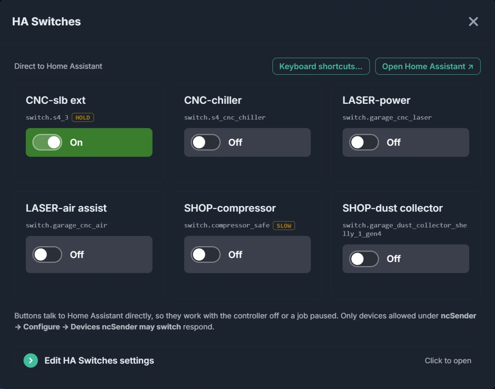
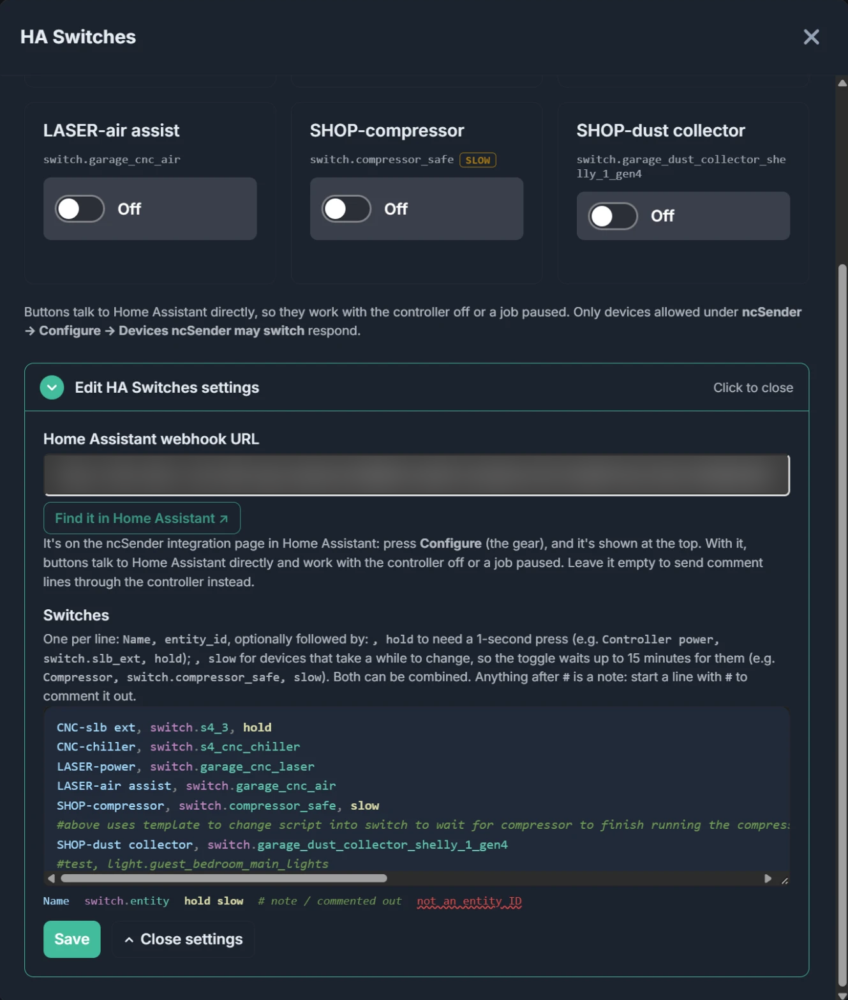

First release from its own repo. Install the ZIP below in ncSender → Settings → Plugins →
*Install Plugin*, then Ctrl+F5; from now on ncSender offers updates from this repo.

Needs the [ha-ncsender](https://github.com/stmoha/ha-ncsender) Home Assistant integration v0.5.0
or later.

**New in 0.1.9**
- **Edit HA Switches settings** bar with a chevron and a "Click to open / Click to close" hint,
  plus a *Close settings* button next to Save.
- The switch list is coloured with ncSender's editor colours: names, entity IDs, `hold` / `slow`,
  `#` notes, and anything that isn't an entity ID underlined in red.

**Also in this release** (0.1.x, developed inside ha-ncsender)
- One toggle per device with live on/off state, pulsing "Switching…" until Home Assistant confirms.
- Works with the controller off, before homing and while paused, through the integration's webhook.
- `hold` (1-second press) and `slow` (wait up to 15 min) per switch; `#` notes and commented-out lines.
- *Keyboard shortcuts…* jumps to ncSender's Controls, filtered to this plugin; *Open Home Assistant* link.

See [CHANGELOG.md](CHANGELOG.md) for the full history.
